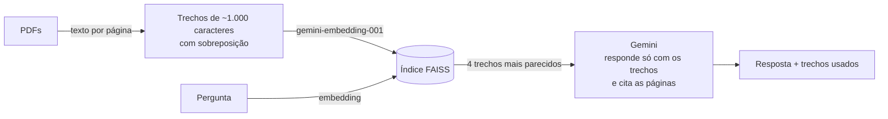

# Chat com PDF (RAG)

Envie um ou mais PDFs e faça perguntas em português. O app busca os trechos mais relevantes e o Gemini responde **citando o arquivo e a página** de onde tirou cada informação. Se a resposta não estiver nos documentos, ele diz que não encontrou, em vez de inventar.

> 📸 _Coloque aqui um print ou GIF do app respondendo uma pergunta._

É a evolução do meu primeiro projeto de IA, o [talk_to_pdf_ai](https://github.com/LeonhardtBN/talk_to_pdf_ai), um notebook com GPT-3.5, agora com interface, várias melhorias e o plano gratuito do Gemini.

## Como funciona (RAG)



1. **Leitura**: o texto é extraído página por página (`pypdf`), guardando o nome do arquivo e o número da página.
2. **Indexação**: as páginas são divididas em trechos com sobreposição (`RecursiveCharacterTextSplitter`), transformadas em vetores com o `gemini-embedding-001` e guardadas num índice FAISS em memória (similaridade de cosseno).
3. **Busca**: a pergunta vira um vetor e o FAISS devolve os 4 trechos mais parecidos.
4. **Resposta**: o Gemini recebe só esses trechos e as últimas mensagens da conversa (para perguntas de acompanhamento), e é instruído a citar `[arquivo, p. N]` e a admitir quando não encontra a resposta.

## O que mudou em relação à versão anterior

- **Fontes nas respostas**: cada resposta cita arquivo e página, e o app mostra os trechos usados.
- **Vários PDFs de uma vez**.
- **O índice não é mais recriado a cada pergunta**: só quando os arquivos mudam (antes, cada interação gerava todos os embeddings de novo, o que deixava o app lento e gastava cota).
- **Memória de conversa** para perguntas de acompanhamento.
- **Gemini no plano gratuito** em vez de OpenAI (o GPT-3.5 foi descontinuado), com imports atuais do LangChain.
- Aviso claro para PDF escaneado (sem texto), `requirements.txt` corrigido e testes automatizados.

## Como rodar

```bash
python -m venv .venv && source .venv/bin/activate   # Windows: .venv\Scripts\activate
pip install -r requirements.txt
cp .env.example .env                                  # Windows: copy .env.example .env
# coloque sua GEMINI_API_KEY no .env (grátis em https://aistudio.google.com/apikey)
streamlit run app.py
```

### Testes

```bash
pytest -q
```

Rodam sem chave de API: usam embeddings e um modelo de chat falsos do LangChain, e PDFs gerados no próprio teste. Cobrem a leitura com página e arquivo, o erro para PDF sem texto, a montagem do prompt com as fontes, a resposta usando os trechos e o histórico, e a detecção de mudança nos arquivos.

## Limitações e próximos passos

- Não faz OCR: PDFs escaneados precisam passar por OCR antes.
- O índice fica em memória; para muitos documentos, usar um banco vetorial persistente.
- Avaliar a qualidade das respostas com um conjunto de perguntas e respostas esperadas.

## Stack

Python · Streamlit · LangChain · FAISS · Gemini API (chat + embeddings) · pypdf · pytest
